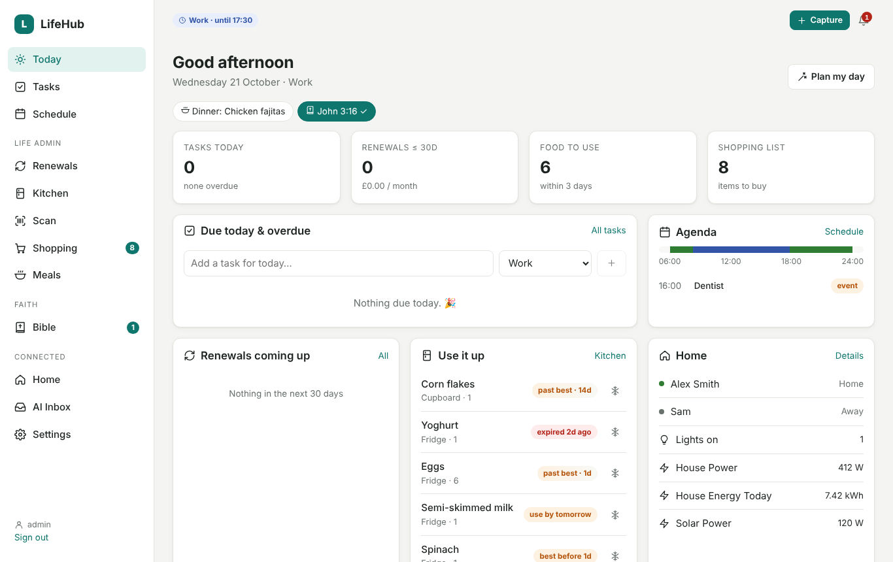
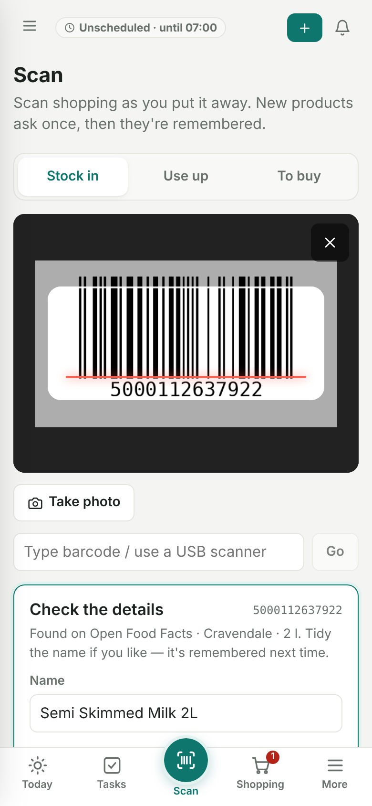

# LifeHub

[](https://github.com/Shotgn16/LifeHub/actions/workflows/build.yml)
[](https://github.com/Shotgn16/LifeHub/releases)
[](LICENSE)


LifeHub is a self-hosted personal organiser. It brings together things that usually live in a dozen
different places:

- **renewals and subscriptions**
- **tasks**
- **kitchen stock, shopping and meal planning**
- your **schedule**
- your **daily Bible reading and studies**
- quick **notes** that sort themselves
- **deals** at supermarkets near you, turned into meal ideas
- **Home Assistant**
- a **local-AI email assistant**, powered by [Ollama](https://ollama.com), that turns emails into
  tasks, calendar events, renewal updates and shopping items without your mail leaving the house

**Several people** can use one LifeHub. Each person has their own tasks, email, Bible tracking and
notes. Food stock, meal planning and renewals can be shared or kept separate.

It's written in **C# / ASP.NET Core 8 + Blazor Server**, with no JavaScript framework. Data is
stored as JSON files in one folder. It ships as one Docker image that runs as a **Home Assistant
add-on**, on **Plesk Obsidian**, or anywhere Docker or .NET 8 runs.

<p align="center">
  
  &nbsp;
  
</p>
<p align="center">
  
  &nbsp;
  
</p>

---

## Features

| Area | What it does |
|---|---|
| **Today** | Shows the current period (work, free or busy), tasks due, your agenda, upcoming renewals, food to use up, and who's home. |
| **Tasks** | Categories, priorities, recurrence, checklists and tags. Repeat issues stack onto one task with a ×N count. |
| **Schedule** | A weekly template of work and free time. Calendar events and holidays override it. **Plan my day** slots tasks into free gaps, and runs automatically every evening. |
| **Renewals** | Domains, hosting, subscriptions, insurance and utilities: cost, cycle, usage, auto-renew. It records price-rise history and reminds you before each date. |
| **Kitchen** | Fridge, freezer and cupboard stock with freeze/defrost and waste tracking. **Use-by** dates count down; **best-before** food (eggs, cereal, pasta…) fades on a scale. **Add from photo** lists your groceries and reads their dates. **Staples** predict when you'll run out. |
| **Scan** | Phone barcode scanner with three modes: stock in, use up, and add to the shopping list. It looks products up on Open Food Facts, learns them after the first scan, and lets you undo. |
| **Shopping** | Grouped by aisle. Only you add items: typed, scanned, from the HA list you choose (two-way, so Assist works) or from the meal planner. Staples running low appear as suggestions. Ticked items go into stock when you put them away. |
| **Meals** | Plan up to two weeks around your calendar and energy. See what to buy, and get AI ideas that move meals, use up food, meet dietary needs (gluten free etc.) and improve recipes. You apply each idea yourself. |
| **People** | Add everyone in the household. Each person has their own tasks, email accounts, AI inbox, schedule, Bible reading, studies, notes, phones and API key. Choose whether food stock and shopping, meal planning, and renewals are shared. In the HA app, LifeHub asks who's using it, with an optional PIN. |
| **Notes** | Drop in bits of text (ideas, links, gift ideas, door codes). The local AI files each one into a category, reusing yours, with tags. **Tidy up** merges near-duplicate categories. Notes are private, or shared one by one. |
| **Deals** | Optional: checks offers at supermarkets near your town or postcode (offers pages, supermarket emails, pasted offers, leaflet photos), matches them to your shopping list, staples, recipes and dietary needs, and suggests meals on days that suit plus when to shop. |
| **Bible** | Verse of the day (same as YouVersion), time in the YouVersion app (HA sensor or iPhone Shortcut), missed readings carried over, reading plan, streaks and coverage. **Studies** with photo/PDF proof, AI reading of handwriting, breakdowns, links between studies, and StudyLight insights shown in purple, never mixed into your notes. **Start a study from a verse**: choose a level and what it's for (personal, home group, preaching, teaching, youth, word study, one-to-one) and get starter notes. |
| **Home** | Home Assistant runs the house; LifeHub gives you one place to see and nudge it. Rooms, lights, climate, scenes, who's home and energy, all shown with friendly names. Setup is automatic. |
| **AI Inbox** | Reads Gmail/IMAP, Microsoft 365 and on-prem Exchange. A local Ollama model classifies each email and proposes actions. Safe actions are applied automatically and can be undone. |
| **Promotions** | Adverts and newsletters go into their own list instead of becoming tasks or shopping items, and clear themselves when they expire. |
| **Email ↔ task link** | Delete a task and its email moves to the Bin. Delete the email and its task goes. |
| **Notifications** | In-app bell plus phone push through **Home Assistant or LifeHub's own web push** (or both): a morning digest, renewal and task reminders, food expiry, Bible reminder, and a "you've left home" shopping list. |
| **REST API** | API-key endpoints for HA automations, Assist, iOS Shortcuts and USB barcode scanners. |

## Quick start

### Home Assistant OS (recommended)

[](https://my.home-assistant.io/redirect/supervisor_add_addon_repository/?repository_url=https%3A%2F%2Fgithub.com%2FShotgn16%2FLifeHub)

1. **Settings → Add-ons → Add-on store → ⋮ → Repositories**, then add `https://github.com/Shotgn16/LifeHub`.
2. Find **LifeHub**, then **Install** (it downloads a ready-made image) and **Start**. Turn on **Show in sidebar**.
3. Open LifeHub from the sidebar. Home Assistant is detected and configured automatically.

### Docker

```bash
git clone https://github.com/Shotgn16/LifeHub.git && cd LifeHub
docker compose up -d --build        # then open http://localhost:8099 and create your login
```

For Plesk, IIS, Cloudflare Tunnel and development setups, see the **[installation guide](docs/installation.md)**.

## Documentation

| Guide | |
|---|---|
| [Installation](docs/installation.md) | Home Assistant, Plesk (Docker, .NET Toolkit, IIS), Docker, development |
| [Remote access & HTTPS](docs/remote-access.md) | Direct port, Cloudflare Tunnel, reverse proxies, HTTPS for the camera |
| [Home Assistant](docs/home-assistant.md) | What's automatic, rooms, shared lists, notifications, sensors, automations |
| [Email & AI](docs/email-and-ai.md) | Ollama, Gmail/IMAP, Microsoft 365, Exchange, classification, auto-apply and undo |
| [Barcode scanner](docs/scanner.md) | Phone camera, photo, USB scanners, product learning |
| [People & sharing](docs/people.md) | Several people, what's shared, signing in, PINs, per-person API keys |
| [Notes](docs/notes.md) | Quick notes, automatic categories, tidy up, sharing |
| [Kitchen, shopping & meals](docs/kitchen-and-meals.md) | Use-by vs best-before, add from photo, shopping rules, meal planner, deals |
| [Bible](docs/bible.md) | Verse of the day, YouVersion app tracking, carry-over, studies, starter notes and AI insights |
| [REST API](docs/api.md) | Endpoints and Home Assistant `rest_command` examples |
| [Architecture](docs/architecture.md) | How the code is organised |
| [Extending LifeHub](docs/extending.md) | New AI actions, mail providers, pages, storage |
| [Data, backups & security](docs/security.md) | Where data lives, encryption, backups |
| [Troubleshooting](docs/troubleshooting.md) | Common problems and fixes |
| [Changelog](CHANGELOG.md) | Version history |

## Project layout

```
.
├── repository.yaml          # makes this repo a Home Assistant add-on repository
├── lifehub/                 # the add-on (also the Docker build context)
│   ├── config.yaml          # add-on manifest (version, ingress, ports)
│   ├── Dockerfile
│   ├── DOCS.md, CHANGELOG.md, icon.png, logo.png
│   └── src/LifeHub/         # the ASP.NET Core / Blazor app
├── docs/                    # documentation
├── tools/                   # publish scripts for Plesk/IIS/Linux
├── docker-compose.yml
└── LifeHub.sln
```

## Requirements

- **To run:** Docker, or the ASP.NET Core 8 runtime. The add-on supports amd64 and aarch64.
- **For AI:** an [Ollama](https://ollama.com) server (0.5 or later) on your network. A 7–8B model
  such as `qwen2.5:7b` works well. Add a vision model such as `qwen3-vl:4b-instruct` for photos and
  handwriting.
- **To build:** the .NET 8 SDK.

## Contributing

Issues and pull requests are welcome. See [CONTRIBUTING.md](CONTRIBUTING.md).

## Licence

[MIT](LICENSE). Bundled third-party components are listed in [THIRD-PARTY-NOTICES.md](THIRD-PARTY-NOTICES.md).
