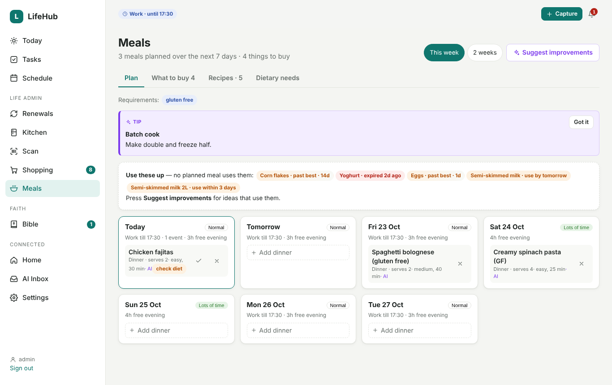

# LifeHub

[](https://github.com/shotgn16/LifeHub/actions/workflows/build.yml)
[](https://github.com/shotgn16/LifeHub/releases)
[](LICENSE)


LifeHub is a household organiser that runs on **your own computer**: Windows, Mac or Linux, Docker, or
Home Assistant, with apps for Android, iPhone and iPad. It brings together things that usually live
in a dozen different places:

- **renewals and subscriptions**
- **tasks**
- **kitchen stock, shopping and meal planning**
- your **schedule**
- quick **notes** that sort themselves
- **deals** at supermarkets near you, turned into meal ideas
- **Home Assistant**
- a **local-AI email assistant**, powered by [Ollama](https://ollama.com), that turns emails into
  tasks, calendar events, renewal updates and shopping items without your mail leaving the house

Use it **on one computer**, **on your computer and your phone**, or as a **server for the whole
household**, where everyone has their own tasks, email and notes. Food stock, meal planning and
renewals can be shared or kept separate.

It's **modular**: switch whole sections on or off, arrange the home screen, pick a theme and accent
colour, or restyle it all with a few lines of CSS. Developers can add a section with one
registration (see [extending.md](docs/extending.md)).

It's written in **C# / ASP.NET Core 8 + Blazor Server**, with no JavaScript framework. Data is
stored as JSON files in one folder.

<p align="center">
  
  &nbsp;
  
</p>
<p align="center">
  
  &nbsp;
  
</p>

---

## Features

| Area | What it does |
|---|---|
| **Today** | Shows the current period (work, free or busy), tasks due, your agenda, upcoming renewals, food to use up, and who's home. |
| **Tasks** | Categories, priorities, recurrence, checklists and tags. Repeat issues stack onto one task with a ×N count. |
| **Schedule** | A weekly template of work and free time. Calendar events and holidays override it. **Plan my day** slots tasks into free gaps, and runs automatically every evening. |
| **Renewals** | Domains, hosting, subscriptions, insurance and utilities: cost, cycle, usage, auto-renew. It records price-rise history and reminds you before each date. |
| **Kitchen** | Fridge, freezer and cupboard stock with freeze/defrost and waste tracking. **Use-by** dates count down; **best-before** food (eggs, cereal, pasta…) fades on a scale. **Add from photo** lists your groceries and reads their dates. **Staples** predict when you'll run out. |
| **Scan** | Phone barcode scanner with three modes: stock in, use up, and add to the shopping list. It looks products up on Open Food Facts, learns them after the first scan, and lets you undo. |
| **Shopping** | Grouped by aisle. Only you add items: typed, scanned, from the HA list you choose (two-way, so Assist works) or from the meal planner. Staples running low appear as suggestions. Ticked items go into stock when you put them away. |
| **Meals** | Plan up to two weeks around your calendar and energy. See what to buy, and get AI ideas that move meals, use up food, meet dietary needs (gluten free etc.) and improve recipes. You apply each idea yourself. |
| **People** | Add everyone in the household. Each person has their own tasks, email accounts, AI inbox, schedule, notes, phones, look and API key. Choose whether food stock and shopping, meal planning, and renewals are shared. In the HA app, LifeHub asks who's using it, with an optional PIN. |
| **Notes** | Drop in bits of text (ideas, links, gift ideas, door codes). The local AI files each one into a category, reusing yours, with tags. **Tidy up** merges near-duplicate categories. Notes are private, or shared one by one. |
| **Deals** | Optional: checks offers at supermarkets near your town or postcode (offers pages, supermarket emails, pasted offers, leaflet photos), matches them to your shopping list, staples, recipes and dietary needs, and suggests meals on days that suit plus when to shop. |
| **Home** | Home Assistant runs the house; LifeHub gives you one place to see and nudge it. Rooms, lights, climate, scenes, who's home and energy, all shown with friendly names. Setup is automatic. |
| **AI Inbox** | Reads Gmail/IMAP, Microsoft 365 and on-prem Exchange. A local Ollama model classifies each email and proposes actions. Safe actions are applied automatically and can be undone. |
| **Promotions** | Adverts and newsletters go into their own list instead of becoming tasks or shopping items, and clear themselves when they expire. |
| **Email ↔ task link** | Delete a task and its email moves to the Bin. Delete the email and its task goes. |
| **Notifications** | In-app bell plus phone push through **Home Assistant or LifeHub's own web push** (or both): a morning digest, renewal and task reminders, food expiry, and a "you've left home" shopping list. |
| **Phone apps** | Android and iPhone apps (`mobile/`): LifeHub signed in as you, notifications, share menu, home-screen shortcuts and Siri & Shortcuts. **They work offline**: tasks, shopping, notes and meals are kept on the phone, and anything you add or tick off is sent when LifeHub is reachable again. Built by GitHub Actions; install them yourself or publish them to the stores. |
| **Make it yours** | Themes (light/dark/auto), accent colour, density, a home screen you arrange, sections you switch on or off, and your own CSS on top of a small set of design tokens. |
| **Desktop apps** | Installers for Windows, macOS and Linux with everything included. A setup assistant runs LifeHub on this computer only, on this computer + your phone, as a household server, in Docker or in Home Assistant, and can install the local AI (Ollama). |
| **REST API** | API-key endpoints for HA automations, Assist, iOS Shortcuts and USB barcode scanners. |

## Quick start

**Download LifeHub from the [Releases page](https://github.com/shotgn16/LifeHub/releases/latest)**
and follow the easy guide for your device:

| | |
|---|---|
| **Windows** 10/11 | [Install guide](docs/manual/windows.md) · `…-Windows-x64-Setup.exe` |
| **Mac** (Apple chip or Intel) | [Install guide](docs/manual/mac.md) · `…-macOS-AppleSilicon.dmg` / `…-Intel.dmg` |
| **Linux** | [Install guide](docs/manual/linux.md) · `.deb` or `.tar.gz` (amd64 / arm64) |
| **Docker** | [Guide](docs/manual/docker.md) · `docker run -d -p 8099:8099 -v lifehub-data:/data ghcr.io/shotgn16/lifehub` |
| **Home Assistant** | [Guide](docs/manual/home-assistant.md) · add the repository `https://github.com/shotgn16/LifeHub` |
| **Android, iPhone, iPad** | [Phone apps](docs/manual/phone-apps.md) · `…-Android.apk` / `…-iPhone-iPad-unsigned.ipa` |

The desktop app opens a **setup assistant** that asks how you want to use LifeHub and sets
everything up. New here? Start with the **[manual](docs/manual/README.md)**.

[](https://my.home-assistant.io/redirect/supervisor_add_addon_repository/?repository_url=https%3A%2F%2Fgithub.com%2Fshotgn16%2FLifeHub)

## Documentation

| Guide | |
|---|---|
| **[Manual](docs/manual/README.md)** | **Easy step-by-step guides: install, set up, phones, customise, problems** |
| [Installation (advanced)](docs/installation.md) | Desktop apps, Home Assistant, Docker, Plesk/IIS, portable server, development, building the installers |
| [Remote access & HTTPS](docs/remote-access.md) | Direct port, Cloudflare Tunnel, reverse proxies, HTTPS for the camera |
| [Home Assistant](docs/home-assistant.md) | What's automatic, rooms, shared lists, notifications, sensors, automations |
| [Email & AI](docs/email-and-ai.md) | Ollama, Gmail/IMAP, Microsoft 365, Exchange, classification, auto-apply and undo |
| [Barcode scanner](docs/scanner.md) | Phone camera, photo, USB scanners, product learning |
| [People & sharing](docs/people.md) | Several people, what's shared, signing in, PINs, per-person API keys |
| [Notes](docs/notes.md) | Quick notes, automatic categories, tidy up, sharing |
| [Kitchen, shopping & meals](docs/kitchen-and-meals.md) | Use-by vs best-before, add from photo, shopping rules, meal planner, deals |
| [Phone apps](docs/mobile-apps.md) | Android & iPhone apps, offline mode, installing them without the stores |
| [Publishing the apps](docs/publishing-apps.md) | Google Play and App Store step by step |
| [AI on your phones](docs/local-ai-on-phones.md) | Local models on Pixel and iPhone, and a phone as LifeHub's AI server |
| [REST API](docs/api.md) | Endpoints and Home Assistant `rest_command` examples |
| [Architecture](docs/architecture.md) | How the code is organised |
| [Extending LifeHub](docs/extending.md) | Modules, home-screen cards, themes, AI actions, mail providers, storage |
| [Data, backups & security](docs/security.md) | Where data lives, encryption, backups |
| [Troubleshooting](docs/troubleshooting.md) | Common problems and fixes |
| [Changelog](CHANGELOG.md) | Version history |

## Project layout

```
.
├── repository.yaml          # makes this repo a Home Assistant add-on repository
├── lifehub/                 # the add-on (also the Docker build context)
│   ├── config.yaml          # add-on manifest (version, ingress, ports)
│   ├── Dockerfile
│   ├── DOCS.md, CHANGELOG.md, icon.png, logo.png
│   └── src/LifeHub/         # the ASP.NET Core / Blazor app
├── mobile/                  # Android (Kotlin) and iPhone/iPad (SwiftUI) apps
├── installer/               # Windows (Inno Setup), macOS (.app/.dmg) and Linux (.deb/.tar.gz) packaging
├── docs/                    # documentation
├── tools/                   # publish scripts for Plesk/IIS/Linux
├── docker-compose.yml
└── LifeHub.sln
```

## Requirements

- **To run:** nothing extra — the desktop installers include everything (Windows 10 1809+/11,
  macOS 12+, Linux with WebKitGTK). Or Docker, or the ASP.NET Core 8 runtime. The add-on and Docker
  image support amd64 and aarch64.
- **For AI (optional):** an [Ollama](https://ollama.com) server (0.5 or later) on the same computer
  or your network — the desktop app can install it for you. A 7–8B model
  such as `qwen2.5:7b` works well. Add a vision model such as `qwen3-vl:4b-instruct` for photos and
  handwriting.
- **To build:** the .NET 8 SDK.

## Contributing

Issues and pull requests are welcome. See [CONTRIBUTING.md](CONTRIBUTING.md).

## Licence

[MIT](LICENSE). Bundled third-party components are listed in [THIRD-PARTY-NOTICES.md](THIRD-PARTY-NOTICES.md).
