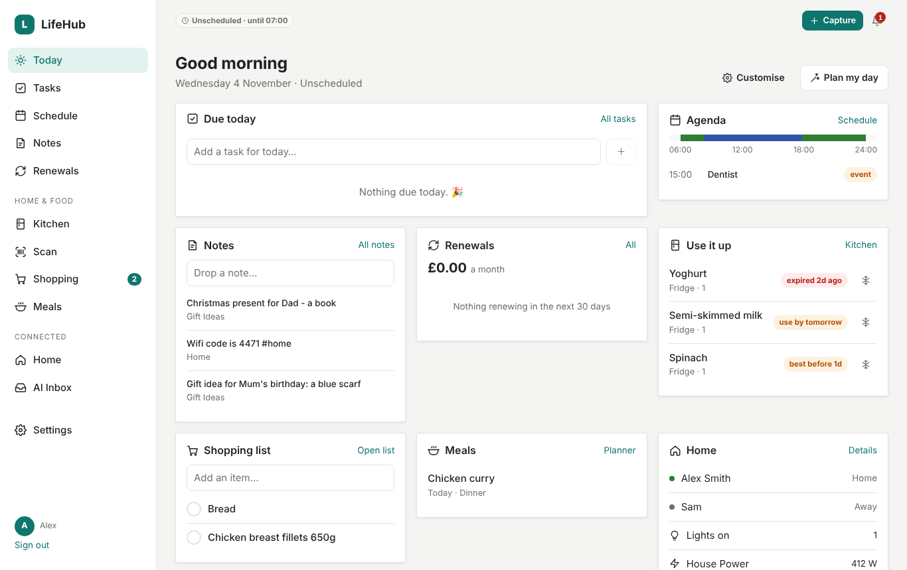
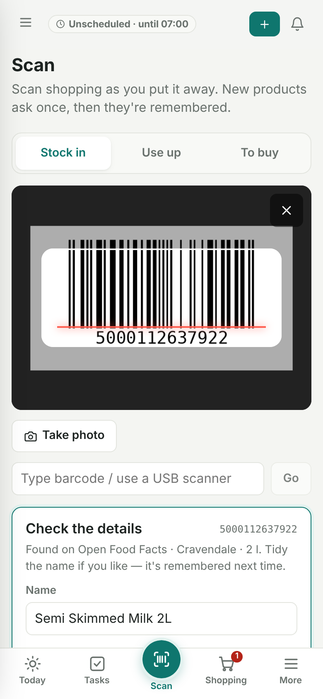
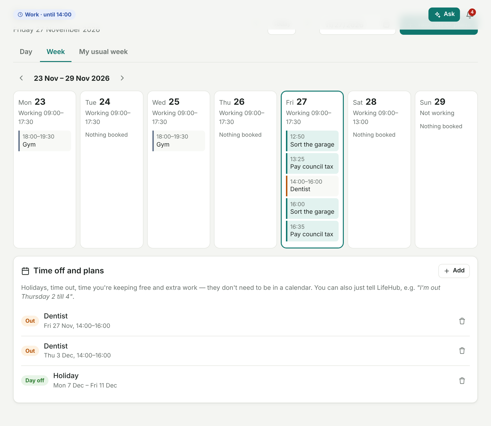
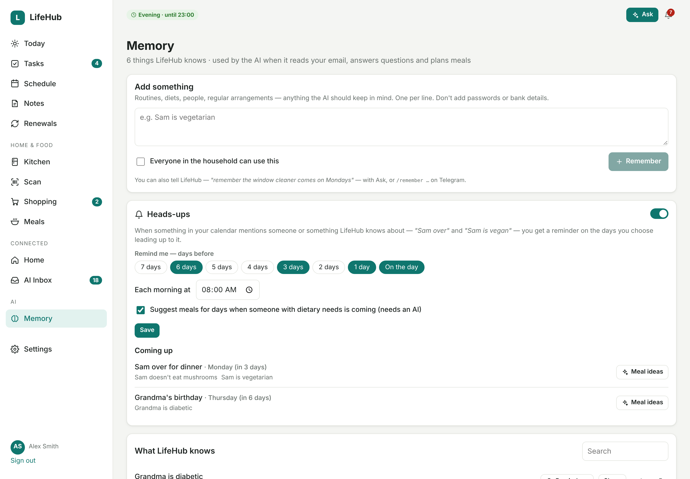
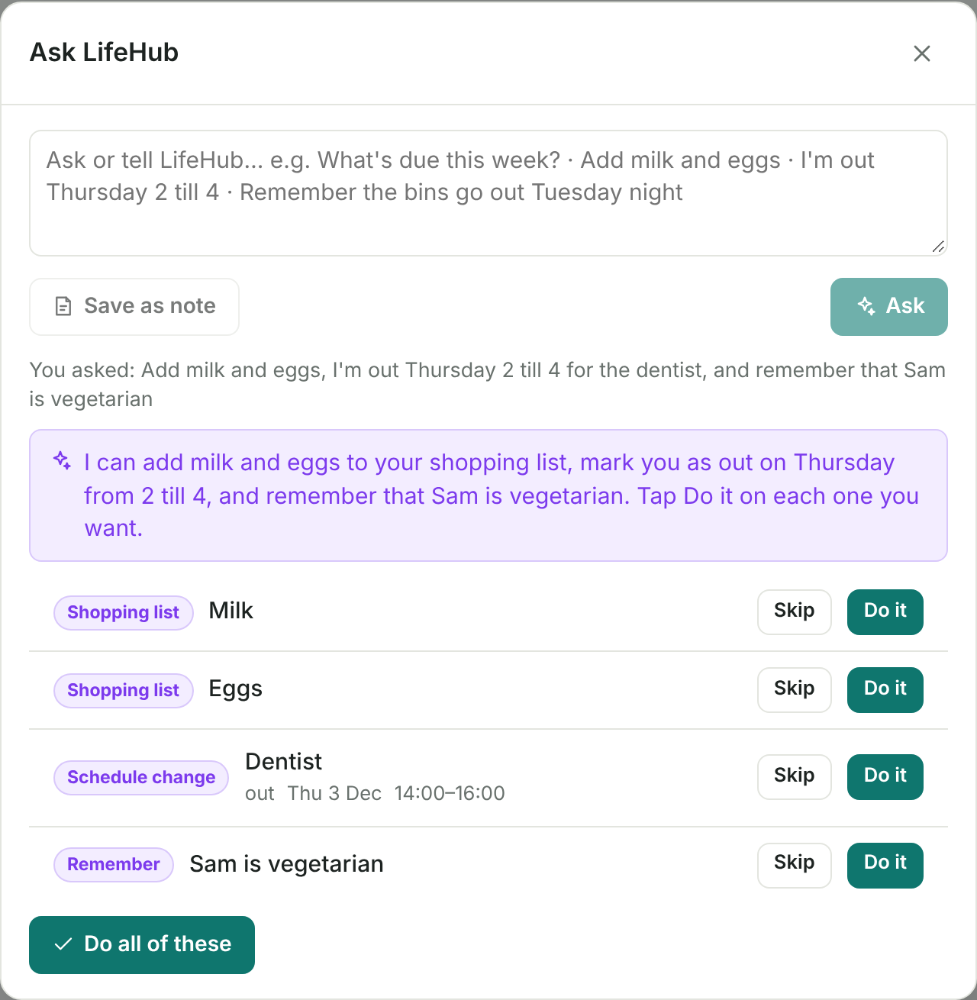

# LifeHub

[](https://github.com/shotgn16/LifeHub/actions/workflows/build.yml)
[](https://github.com/shotgn16/LifeHub/releases)
[](LICENSE)


LifeHub is a household organiser that runs on **your own computer**: Windows, Mac or Linux, Docker, or
Home Assistant, with apps for Android, iPhone and iPad. It brings together the things that usually
live in a dozen different places — **tasks, your week, renewals, the kitchen, shopping, meals and
notes** — and adds an AI that **answers questions, remembers what matters to you and reads your
email**, without your data leaving the house.

- **Ask it anything:** *"what's due this week?"*, *"add milk and eggs"*, *"I'm out Thursday 2 till
  4"* — in the app or on **Telegram**. It always asks before changing anything.
- **It remembers:** tell it *"Sam is vegan"* or *"bins go out Tuesday night"*. It reminds you of bin
  day, and when *"Sam over"* appears in your calendar it gives you a heads-up in the days before —
  and suggests a vegan dinner for that day.
- **It knows your week:** the days and hours you work, holidays, time out and time you keep free,
  so **Plan my day** fits your tasks into the gaps.
- **It reads your email** (Gmail, Outlook, iCloud, Exchange…) and turns it into tasks, events,
  renewals and shopping — one tidy notification per check, never adverts.
- **Your AI, your choice:** Ollama on your own computer, a model on your phone, or ChatGPT, Gemini
  or Claude. Everything LifeHub stores is **encrypted**.

Use it **on one computer**, **on your computer and your phone**, **on your phone on its own**, or as
a **server for the whole household**, where everyone has their own tasks, email, schedule and
memory. Food, meals and renewals can be shared or kept separate.

Everything is a **module** you can switch off, the home screen is yours to arrange, and it works in
light and dark. It's written in **C# / ASP.NET Core 8 + Blazor**, with no JavaScript framework.

<p align="center">
  
  &nbsp;
  
</p>
<p align="center">
  
  &nbsp;
  
</p>
<p align="center">
  
  &nbsp;
  
</p>

---

## Features

### Everyday

| | |
|---|---|
| **Today** | What kind of time it is (work, free, out), tasks due, your agenda, renewals coming up, food to use up and who's home — arranged how you like. |
| **Tasks** | Categories, priorities, repeats, checklists and tags. Repeat issues stack onto one task with a ×N count. |
| **Schedule** | **My usual week** in plain terms — the days and hours you work, when your day starts and ends, regular times to keep free (gym, school run). **Time off and plans** for holidays, days off, time out, reserved time and extra shifts, even when they're not in a calendar. Day and week views. **Plan my day** fits tasks into free gaps, and can run every evening. |
| **Renewals** | Domains, hosting, subscriptions, insurance and bills: cost, cycle, usage, auto-renew, price-rise history and reminders before each date. |
| **Notes** | Drop in bits of text (ideas, links, gift ideas, door codes). The AI files each one into a category with tags; **Tidy up** merges near-duplicates. Private, or shared one by one. |
| **Notifications** | Phone push through Home Assistant, LifeHub's own web push, the phone app or **Telegram**. Choose per kind (reminders, renewals, food, email, heads-ups, morning summary…) whether it reaches your phone, with quiet hours. |

### Kitchen and food

| | |
|---|---|
| **Kitchen** | Fridge, freezer and cupboard stock. **Use-by** dates count down; **best-before** food fades on a scale. **Add from photo** lists groceries and reads their dates. **Staples** predict when you'll run out. |
| **Scan** | Phone barcode scanner: stock in, use up, add to shopping. Looks products up on Open Food Facts and learns them. |
| **Shopping** | Grouped by aisle, shared two-way with a Home Assistant list (so Assist works), with staples running low as suggestions. Ticked items go into stock. |
| **Meals** | Plan up to two weeks around your calendar and energy, see what to buy, and get AI ideas that move meals, use up food, meet dietary needs — and suit **guests**: it knows when someone vegan is coming and suggests a meal for that day. You apply each idea. |
| **Deals** | Optional: offers at supermarkets near you, matched to your list, staples, recipes and diet, with meal ideas. |

### Your AI

| | |
|---|---|
| **Ask LifeHub** | One box for questions (*"am I free Thursday afternoon?"*) and requests (*"add milk"*, *"I'm out Thursday 2–4"*, *"I paid the council tax"*). It answers from your own lists and week, and every change waits for **Do it**. |
| **Memory** | Its own page: everything LifeHub knows — diets, routines, people — added by you (one per line, the **Remember** button, or `/remember` on Telegram). Shared with the household or kept to yourself. Never saves passwords. |
| **Remind me** | Turn any memory into a repeating reminder: *"bins go out Tuesday night"* → every Tuesday at 19:00. |
| **Heads-ups** | When a calendar event mentions someone LifeHub remembers (*"Sam over"* + *"Sam is vegan"*), you're reminded on the days you choose — a week before down to the day itself — with meal ideas for their diet. |
| **AI Inbox** | Reads Gmail/IMAP, Outlook/Microsoft 365, iCloud, Yahoo and Exchange (add a mailbox in a few clicks — **Sign in with Microsoft** or guided app passwords). Each email becomes suggested tasks, events, renewals or shopping; safe ones can apply themselves and be undone. Adverts go to **Promotions**. |
| **Telegram** | Chat with LifeHub from Telegram: ask, add, tick off, with buttons to confirm, and get notifications there. Each person connects their own chat with a one-time code. |
| **Any AI** | Ollama on your own computer (private, free), a model running on the phone, or ChatGPT, Gemini, Claude or any OpenAI-compatible server. |

### Your home, your way

| | |
|---|---|
| **People** | Everyone in the household has their own tasks, email, AI inbox, schedule, memory, notes, phones, look and API key. Choose what's shared. In the HA app, LifeHub asks who's using it, with an optional PIN. |
| **Home** | Rooms, lights, climate, scenes, who's home and energy from Home Assistant, with friendly names. Set up automatically. |
| **Modules** | Switch off anything you don't use — pages like Kitchen or Meals, and features like Ask, Memory or Telegram. |
| **Make it yours** | Light, dark or automatic, accent colour, density, a home screen you arrange, and your own CSS on top of a small set of design tokens. |
| **Background tasks** | Everything LifeHub does by itself (email checks, reminders, heads-ups, backups, Home Assistant sync…) can be switched off, rescheduled or run now. |
| **Private by design** | Everything is encrypted (AES-256), with the key in Windows' DPAPI, the phone's keystore or a locked-down key file. Backups are encrypted too, with a recovery key. |

### Runs anywhere

| | |
|---|---|
| **Desktop apps** | Installers for Windows, macOS and Linux with everything included. A setup assistant runs LifeHub on this computer, for this computer + your phone, as a household server, in Docker or in Home Assistant, and can install Ollama. |
| **Home Assistant add-on** | Install from this repository; it finds your people, calendars, phones and lists by itself. |
| **Phone apps** | One app for Android, iPhone and iPad. **Use it on its own** (LifeHub on the phone for one person, encrypted, with email checked in the background and an AI on the phone) or **connect it to your LifeHub** with an offline copy. |
| **REST API** | API-key endpoints for Home Assistant automations, Assist, iOS Shortcuts and USB barcode scanners — including Ask and Memory. |

## Quick start

**Download LifeHub from the [Releases page](https://github.com/shotgn16/LifeHub/releases/latest)**
and follow the easy guide for your device:

| | |
|---|---|
| **Windows** 10/11 | [Install guide](docs/manual/windows.md) · `…-Windows-x64-Setup.exe` |
| **Mac** (Apple chip or Intel) | [Install guide](docs/manual/mac.md) · `…-macOS-AppleSilicon.dmg` / `…-Intel.dmg` |
| **Linux** | [Install guide](docs/manual/linux.md) · `.deb` or `.tar.gz` (amd64 / arm64) |
| **Docker** | [Guide](docs/manual/docker.md) · `docker run -d -p 8099:8099 -v lifehub-data:/data ghcr.io/shotgn16/lifehub` |
| **Home Assistant** | [Guide](docs/manual/home-assistant.md) · add the repository `https://github.com/shotgn16/LifeHub` |
| **Android, iPhone, iPad** | [Phone apps](docs/manual/phone-apps.md) · `…-Android.apk` / `…-iPhone-iPad-unsigned.ipa` |

The desktop app opens a **setup assistant** that asks how you want to use LifeHub and sets
everything up. New here? Start with the **[manual](docs/manual/README.md)**.

[](https://my.home-assistant.io/redirect/supervisor_add_addon_repository/?repository_url=https%3A%2F%2Fgithub.com%2Fshotgn16%2FLifeHub)

## Documentation

| Guide | |
|---|---|
| **[Manual](docs/manual/README.md)** | **Easy step-by-step guides: install, set up, phones, customise, problems** |
| [Installation (advanced)](docs/installation.md) | Desktop apps, Home Assistant, Docker, Plesk/IIS, portable server, development, building the installers |
| [Remote access & HTTPS](docs/remote-access.md) | Direct port, Cloudflare Tunnel, reverse proxies, HTTPS for the camera |
| [Home Assistant](docs/home-assistant.md) | What's automatic, rooms, shared lists, notifications, sensors, automations |
| [Ask, memory & Telegram](docs/manual/ask-and-telegram.md) | Ask LifeHub, Memory, reminders, heads-ups and the Telegram chat |
| [Your schedule](docs/manual/schedule.md) | Your usual week, time off and plans, Plan my day |
| [Email & AI](docs/email-and-ai.md) | Ollama, Gmail/IMAP, Microsoft 365, Exchange, classification, auto-apply and undo |
| [Barcode scanner](docs/scanner.md) | Phone camera, photo, USB scanners, product learning |
| [People & sharing](docs/people.md) | Several people, what's shared, signing in, PINs, per-person API keys |
| [Notes](docs/notes.md) | Quick notes, automatic categories, tidy up, sharing |
| [Kitchen, shopping & meals](docs/kitchen-and-meals.md) | Use-by vs best-before, add from photo, shopping rules, meal planner, deals |
| [Phone apps](docs/mobile-apps.md) | Android & iPhone apps, offline mode, installing them without the stores |
| [Publishing the apps](docs/publishing-apps.md) | Google Play and App Store step by step |
| [AI on your phones](docs/local-ai-on-phones.md) | Local models on Pixel and iPhone, and a phone as LifeHub's AI server |
| [REST API](docs/api.md) | Endpoints and Home Assistant `rest_command` examples |
| [Architecture](docs/architecture.md) | How the code is organised |
| [Extending LifeHub](docs/extending.md) | Modules, home-screen cards, themes, AI actions, mail providers, storage |
| [Data, backups & security](docs/security.md) | Where data lives, encryption, backups |
| [Troubleshooting](docs/troubleshooting.md) | Common problems and fixes |
| [Changelog](CHANGELOG.md) | Version history |

## Project layout

```
.
├── repository.yaml          # makes this repo a Home Assistant add-on repository
├── lifehub/                 # the add-on (also the Docker build context)
│   ├── config.yaml          # add-on manifest (version, ingress, ports)
│   ├── Dockerfile
│   ├── DOCS.md, CHANGELOG.md, icon.png, logo.png
│   └── src/LifeHub/         # the ASP.NET Core / Blazor app
├── mobile/                  # the phone app for Android, iPhone and iPad (.NET MAUI)
├── installer/               # Windows (Inno Setup), macOS (.app/.dmg) and Linux (.deb/.tar.gz) packaging
├── docs/                    # documentation
├── tools/                   # publish scripts for Plesk/IIS/Linux
├── docker-compose.yml
└── LifeHub.sln
```

## Requirements

- **To run:** nothing extra — the desktop installers include everything (Windows 10 1809+/11,
  macOS 12+, Linux with WebKitGTK). Or Docker, or the ASP.NET Core 8 runtime. The add-on and Docker
  image support amd64 and aarch64.
- **For AI (optional):** an [Ollama](https://ollama.com) server (0.5 or later) on the same computer
  or your network — the desktop app can install it for you. A 7–8B model such as `qwen2.5:7b`
  works well; add a vision model such as `qwen3-vl:4b-instruct` for photos and handwriting. Or use
  ChatGPT, Gemini or Claude with an API key, or the AI built into the phone app.
- **To build:** the .NET 8 SDK.

## Contributing

Issues and pull requests are welcome. See [CONTRIBUTING.md](CONTRIBUTING.md).

## Licence

[MIT](LICENSE). Bundled third-party components are listed in [THIRD-PARTY-NOTICES.md](THIRD-PARTY-NOTICES.md).
