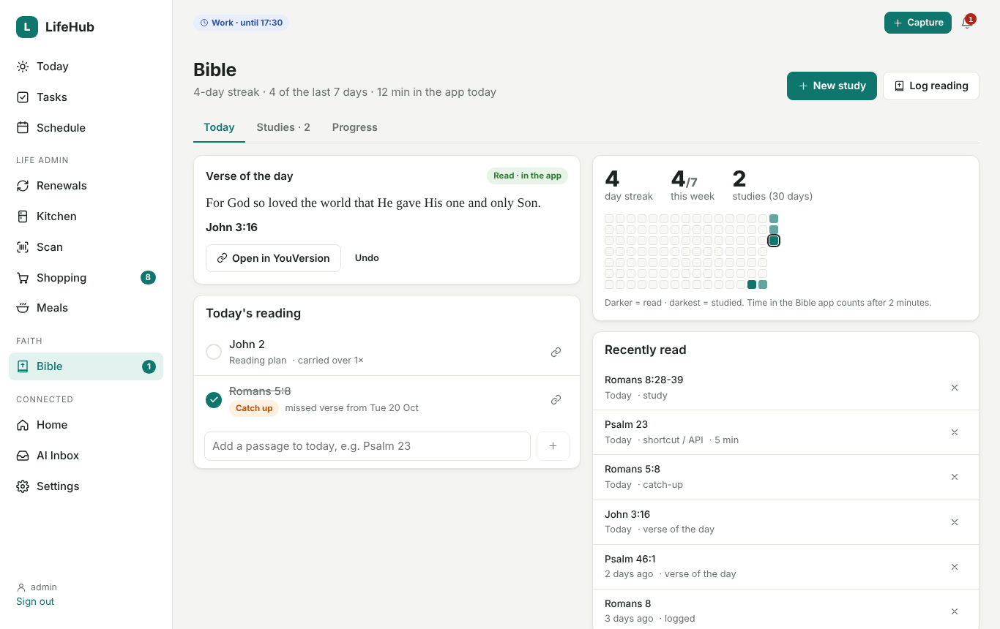
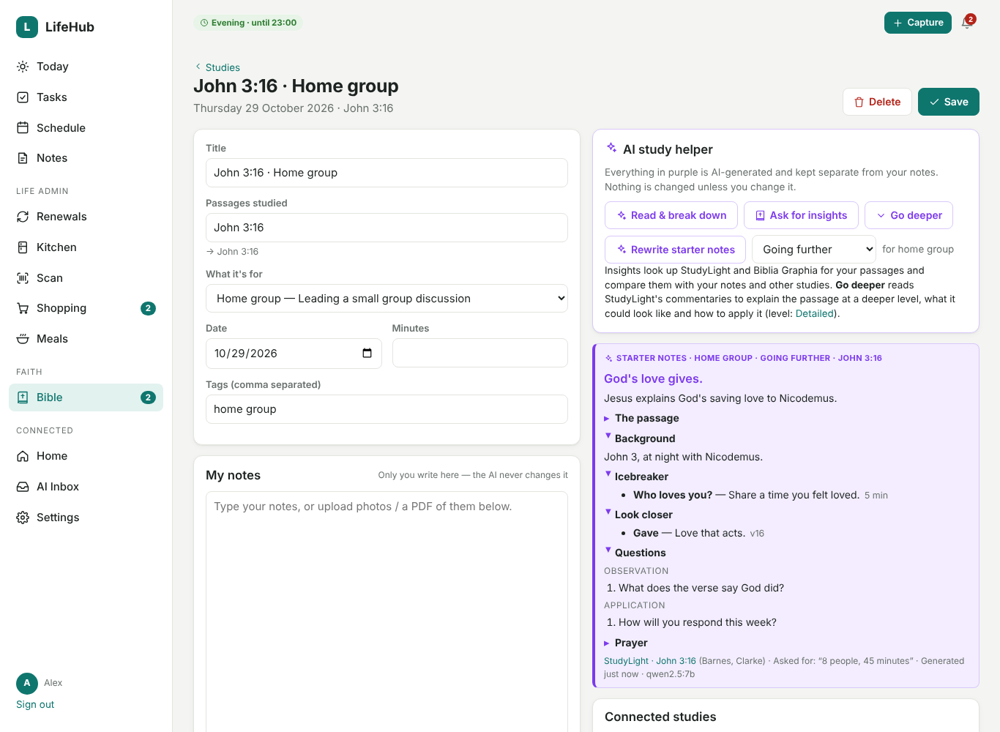

# Bible

The Bible section keeps your daily reading on track and keeps your studies in one place. It has
three tabs:

- **Today**: the verse of the day, today's reading list (including anything you missed), your
  streak and what you've read recently.
- **Studies**: your study notes, with photos, scans or PDFs as proof of study, plus AI help that's
  always kept separate from your own words.
- **Progress**: chapters and books read across the Bible.

You can turn the section on or off in **Settings → Bible**.



## Verse of the day

LifeHub can show **the same verse of the day as the YouVersion app**:

1. Sign in at [platform.youversion.com](https://platform.youversion.com), create an app and copy
   its **app key**. It's free.
2. Paste it into **Settings → Bible → YouVersion app key**, choose a Bible version, and press
   **Save & fetch today's verse**.

Without a key you can type the day's verse on the Bible page. Either way, **Open in YouVersion**
opens the passage in the app on your phone.

Some versions aren't licensed for apps like LifeHub. In that case you get the reference and link
but no verse text, so try BSB or KJV.

## What you read: share from YouVersion (most accurate)

Time in the app can't tell LifeHub **which** passage you read, but sharing from YouVersion can.

- **Android.** Open LifeHub in Chrome at your HTTPS address, then ⋮ → **Add to Home screen**
  (Install). In YouVersion, select the verses (or a whole chapter's worth), then **Share** →
  **LifeHub**.
- **iPhone.** Make a shortcut called **Log in LifeHub**:
  - Turn on *Show in Share Sheet*, accepting URLs and Text.
  - Add the action **Get Contents of URL**, with URL `https://<your LifeHub address>/api/v1/bible/read`
    and Method POST.
  - Add the header `X-Api-Key` (from Settings → Security & API).
  - Set the request body to JSON, with `reference` = *Shortcut Input*.
  - Then in YouVersion: select the verses → **Share** → **Log in LifeHub**.

LifeHub reads the bible.com link or the reference in the shared text, for example
`John 3:16-18 NIV`, and logs that passage. If it matches the verse of the day or something on
today's list, those are ticked too.

### "What did you read?"

On **Bible → What did I read?** you can log in one tap:

- today's verse
- your plan and catch-up readings
- **carry on** suggestions, such as the next chapter after the last one you read, or the rest of a
  chapter you part-read
- anything you type

Optionally (Settings → Bible, off by default), LifeHub can send **one** "What did you read?"
notification after a reading session, linking to this page.

## Time in the YouVersion app (automatic)

Once it's set up, time in YouVersion is **logged automatically**, with nothing to tap:

- each session appears in **Recently read** as "Time in the Bible app · 12 min"
- it counts towards your streak and heatmap
- a few minutes in the app (2 by default) ticks off the verse of the day

### Android (through Home Assistant)

1. In the **Home Assistant Companion app**, go to Settings → Companion app → Manage sensors.
2. Turn on **Last used app** and **Interactive** (screen on/off).
3. For better timing, set *Sensor update frequency* to **Fast always** on the same screen.
4. In LifeHub, go to **Settings → Bible** and tick your phone. A green **screen on/off ✓** shows
   the Interactive sensor was found.

How LifeHub works out the time:

- Every minute, sessions are rebuilt from Home Assistant's history.
- A session counts only while YouVersion is in front **and** the screen is on. "Last used app"
  keeps saying *Bible* after you lock the phone, so on its own it over-counts.
- Without the Interactive sensor, sessions are capped at 30 minutes.
- Visits under 45 seconds are ignored (this is adjustable).
- Popping out for up to 2 minutes, for example to answer a message, is merged into the same session.

Today's sessions are listed on the Bible page and the "What did you read?" page. Use **Wasn't
reading** for any that shouldn't count. If that leaves less than the minimum, the automatic verse
tick is removed.

### iPhone (Shortcuts)

iOS doesn't share app usage with Home Assistant, so use two small Shortcuts automations:

1. Open **Shortcuts → Automation → + → App**, choose **Bible** (that's YouVersion), pick **Is
   Opened**, then **Run Immediately**.
2. Add the action **Get Contents of URL**:
   - **URL:** `https://<your LifeHub address>/api/v1/bible/app`
   - **Method:** POST
   - **Header:** `X-Api-Key`
   - **Request Body:** JSON, with `event` = `opened`
3. Make a second automation for **Is Closed**, with `event` = `closed`.

Sessions are capped at 45 minutes, in case a "closed" never arrives.

## Staying on track

- **Carry-over.** If you don't read the verse of the day, it's added to tomorrow's list as a
  **Catch up** item. Unfinished plan readings move forward too, and each shows how many times it
  has been carried.
- **Reading plan (optional).** Choose a book and how many chapters a day. LifeHub adds the next
  chapters each day and moves on to the next book when one ends. Missed chapters don't pile up:
  new ones are only added once you've caught up.
- **Reminder.** If you haven't read by the time you set (20:30 by default), you get a notification
  with today's verse and anything left on your list.
- **Streak and heatmap.** A day counts as read if you read the verse, logged a reading, ticked a
  plan item, studied, or spent the minimum time in the app.
- **Recently read** lists every passage logged, wherever it came from: verse of the day, plan,
  catch-up, study, typed in, or the API.

## Start a study from a verse

On **Bible → Studies**, use **Start a study from a verse**. Type a passage (for example `John 15:1-8`),
choose how deep to go and what the study is for, then press **Create starter notes**.



| How deep | |
|---|---|
| **Getting started** | Plain language, the main points, no background needed |
| **Going further** | More background, some original-language words, fuller notes |
| **In depth** | Detailed exegesis, Greek/Hebrew, where interpreters differ, more cross-references |

| What it's for | The starter notes contain |
|---|---|
| **Personal study** | Read and notice, what it shows about God, reflect and respond, prayer |
| **Home group** | Icebreaker, how to read it together, look closer, what it means, live it out, leader's notes (timings, sensitive topics), observation / interpretation / application questions, prayer points |
| **Preaching** | Big idea, verse-by-verse exegetical notes, a 3–4 point outline with illustration ideas, introduction ideas, application, conclusion and response, things to watch out for |
| **Teaching** | Learning aims, background, a lesson plan with timings, key truths, activities |
| **Youth & children** | Opening activity, the story in simple words, the big truth, a response activity |
| **Word & theme study** | Key words in Greek/Hebrew, the theme across Scripture, what it teaches |
| **One-to-one** | Reading together, conversation starters, what it means for us, a challenge for the week |

Add anything to keep in mind, such as "8 people, 45 minutes, some new to the Bible" or
"25-minute sermon, part of a series on John".

LifeHub creates a new study and writes the starter notes from:

- the passage text, in your Bible version (with a YouVersion key)
- StudyLight's commentaries, read in small pieces like **Go deeper**
- your local AI

The notes are shown in **purple** above your own notes, which stay empty for you to write in. You
can then use **Go deeper**, **Ask for insights** and the rest as usual. Go deeper also shapes its
applications for the study's type.

On an existing study you can:

- set **What it's for**
- press **Starter notes**, or **Rewrite starter notes**, at a different depth

The Studies list can be filtered by type, for example all your home group studies or sermons.

## Bible studies

Press **New study** and add:

- a title
- the passages you studied (any common format works: `Rom 8:28-39; 12:1-2`, `1 Cor 13`, `Ps 23`)
- your notes
- **proof of study**: photos of handwritten notes (**Take photo** on a phone), scans, PDFs, Word
  documents or text files

### What the local AI does (in purple)

Everything the AI produces is shown in **purple**, labelled as AI-generated, and stored separately
from your notes. **It never changes your notes.**

- **Reads your uploads.** A vision model transcribes handwriting and scans. PDFs with a text layer
  are read directly. You can expand **AI-read text from your uploads** to check it.
- **Breaks the study down** into:
  - a summary and key points
  - the passages mentioned (one tap adds them to your passages)
  - themes and Bible people
  - questions and applications or prayer points
- **Connected studies.** Other studies are linked when they share passages, themes or people. With
  an embedding model, studies with similar ideas are linked too. You'll also see when you've read
  the same passage before.

### Ask for insights (StudyLight & Biblia Graphia)

**Ask for insights** only runs when you press it:

1. LifeHub fetches the pages for your passages from the reference sites you've enabled in
   Settings → Bible.
2. It sends them, your notes and your related studies to your local AI.
3. You get 4–8 short insights:

| Kind | What it is |
|---|---|
| Connection | A link between your notes and a source, passage or other study |
| Go deeper | A point you could expand, and how |
| Background | Historical, cultural or literary context |
| Cross-references | Other passages that shed light on this one |
| Question to explore | Something to study or pray about next |
| Link to another study | A specific connection to one of your studies |

Each insight shows its source, linked where possible. **Pin** the ones you want to keep (pinned
insights survive a refresh) and dismiss the rest.

**Sites:**

- **StudyLight.org** works out of the box. LifeHub reads the commentary page for the first verse of
  each passage.
- **Biblia Graphia** builds its pages in the browser with JavaScript, so LifeHub usually can't read
  them. You'll see a note saying so, and **Read more** still links you there.

Both URL patterns are editable in Settings → Bible. You can use the placeholders `{book}`,
`{name}`, `{chapter}`, `{verse}` and `{usfm}`.

### Go deeper

**Go deeper** turns StudyLight's commentaries on your passage into a deeper explanation. It covers:

- **How it can be understood:** the main interpretations, with who holds each (for example
  "Barnes, Clarke"), including where Christian traditions differ
- **Background:** historical, cultural and literary context
- **Word studies:** key Greek or Hebrew words and what they mean
- **Cross-references** and **themes**
- **What this could look like:** everyday situations where the passage is lived out
- **How to apply it:** concrete practices for different areas of life
- **Questions to reflect on** and a short **prayer**

It's shown in purple below your study, with the StudyLight pages and commentators credited. Your
notes are never changed. Press it again to regenerate, for example after changing the depth.

Set it up in **Settings → Bible → Go deeper**:

| Option | Effect |
|---|---|
| How deep: **Overview** | One commentary page, a short summary. About a minute on an 8 GB Mac. |
| How deep: **Detailed** (default) | Two pages per passage, several commentators, fuller applications. A few minutes. |
| How deep: **In-depth study** | Up to six pages, differing views, more word studies and scenarios. Slowest, so best on a bigger machine. |
| Word studies | Include Greek/Hebrew word studies, or leave them out |
| Questions and prayer | Include them, or leave them out |
| Focus | Where the applications should focus, e.g. "family life, my small group, work" |

To fit small machines, LifeHub reads the commentary in pieces and summarises each piece on its own
before writing the study. Deeper levels make more of these calls, which is why they take longer.

### Models

| Purpose | Setting | Suggested |
|---|---|---|
| Breakdown and insights | Settings → AI → Model | `qwen2.5:7b` |
| Reading handwriting and scans | Settings → AI → **Vision model** | `qwen3-vl:4b-instruct` (8 GB), `qwen3-vl:8b-instruct` (16 GB+), `gemma3:4b` |
| Linking studies by meaning (optional) | Settings → AI → **Embedding model** | `nomic-embed-text` |

## Home Assistant

`sensor.lifehub_bible_streak` has the streak as its state. Its attributes are `read_today`,
`verse`, `verse_read`, `app_minutes_today` and `to_read`. Example: light a lamp at 9pm if you
haven't read yet.

```yaml
automation:
  - alias: Bible reading nudge
    triggers:
      - trigger: time
        at: "21:00:00"
    conditions:
      - condition: template
        value_template: "{{ not state_attr('sensor.lifehub_bible_streak', 'read_today') }}"
    actions:
      - action: light.turn_on
        target: { entity_id: light.reading_lamp }
```

## Several people

Each person has their own reading, verse of the day, app sensor, reading plan, reminder, streak and
studies (see [people.md](people.md)). The YouVersion app key and the study sites are set once for
everyone by an admin. With several people, each gets `sensor.lifehub_bible_streak_<name>`; the main
person keeps `sensor.lifehub_bible_streak`. In iPhone Shortcuts, use **your own** API key so the
time is logged to you.

## API

See [api.md](api.md#bible). The endpoints are `POST /api/v1/bible/app`,
`POST /api/v1/bible/read` and `GET /api/v1/bible/today`.
