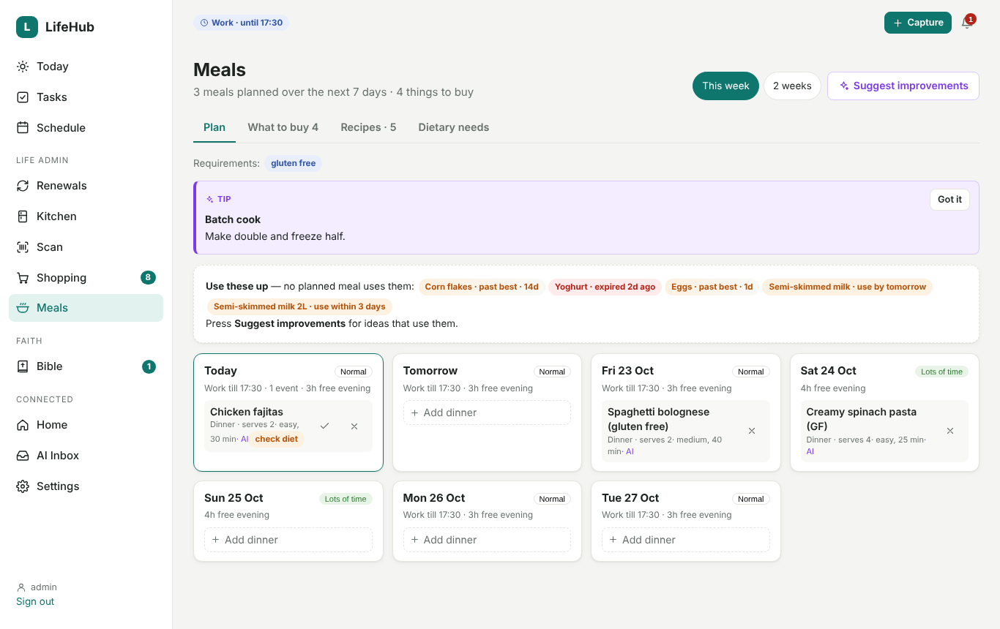

# Kitchen, shopping & meals

## Kitchen stock

The **Kitchen** page lists everything in the fridge, freezer and cupboards. You can add things by:

- typing them in
- [scanning barcodes](scanner.md)
- putting away ticked shopping
- taking a photo of your shopping (see below)

### Use-by vs best-before (eggs, cereal, pasta…)

Not all food goes off the same way:

| Date type | Examples | How LifeHub shows it |
|---|---|---|
| **Use by** (safety) | milk, meat, fish, yoghurt, ready meals | Counts down to the date, then **expired** |
| **Best before** (quality) | eggs, cereal, pasta, rice, tins, bread, crisps, jars, coffee, fruit and veg | Fades gradually: **fresh → best before soon → past best (usually still fine) → check before using** |

Each item has a small bar showing where it is in its life. Hover over (or long-press) the badge to
see the details.

- **Opened** items such as cereal, crisps and jars go stale sooner. Their life is counted from the
  day you opened them; for cereal that's about 8 weeks.
- **No date on the pack?** Leave the date empty and LifeHub estimates one from the staple or food
  type. Estimates are marked with **~**.
- **Reminders** are less naggy for soft dates. Use-by food is flagged as its date approaches;
  best-before food is only flagged near the date and again when it needs checking.

LifeHub guesses the date type from the name. You can override it per item when editing, or per
staple: date type, *keeps once opened (days)*, and *usually fine after best before (days)*.

> These are typical guidelines, not food-safety advice. Always follow the pack and your own judgement.

### Add from photo

Go to **Kitchen → Add from photo**.

1. **Take or choose photos** of your shopping. Spread things out with the labels facing the camera.
   One photo per bag works well.
2. The local **vision model** lists each item, how many there are, and where it should be kept. If
   a use-by or best-before date is clearly readable, it's copied (shown in purple as *read: 12
   NOV*). Dates are never guessed.
3. For items **without a readable date**, do one of these:
   - tick *in next photo* on the ones you'll photograph, then press **Photo of their dates** and
     take a close-up of their labels (one photo can cover several items)
   - press **Estimate**, or **Use typical dates** for all of them
   - type the date in yourself
4. Check names, quantities and places, then press **Add to kitchen**.

LifeHub understands most date formats: `12 NOV`, `12 Nov 2026`, `24/10/26`, `24.10.2026`,
`2026-10-24`, `03/2027` and `NOV 2027` (month-only dates mean the end of that month). The order of
day and month follows your culture setting.

You need a vision model set in **Settings → AI**: `qwen3-vl:4b-instruct` (8 GB), `qwen3-vl:8b-instruct` or
`gemma3:4b`.

## Shopping list

**Only you add things to the shopping list.** Items come from:

- typing them in on the Shopping page, or a quick-capture note ("need coffee")
- scanning in *To buy* mode
- the **Home Assistant to-do list** you choose in Settings → Home Assistant, which syncs both
  ways, so Assist voice works
- **What to buy** in the meal planner, when you press *Add to shopping list*
- the REST API

LifeHub **never** adds items from emails, adverts or its own predictions. Staples that are
running low, only have old stock, or that you usually buy about now appear as **Suggestions** at
the top of the Shopping page. Tap one to add it, or **Add all**.

*Upgrading from 1.2: items LifeHub had added by itself are removed once, and you get a
notification saying how many.*

## Meal planner

The **Meals** page plans **this week or the next two weeks**.

### Planning

- Each day shows what your calendar leaves you: work hours, events and free evening time. It also
  shows an **energy** label: low energy, normal, or lots of time. Tap the label to set it yourself,
  for example after a long day.
- **Add a meal** to any slot (Breakfast, Lunch or Dinner; choose which in *Dietary needs*). Pick
  one of your recipes or type anything ("Takeaway", "Leftovers").
  - For a new dish, press **Draft a recipe**. The AI writes one that meets your requirements, and
    its ingredients then count towards the shopping.
- Tick a meal when you've **cooked** it. Countable ingredients (eggs, onions) come off your kitchen
  stock, and packs (rice, flour) are marked as opened.

### What to buy

This adds up the ingredients of every planned meal, scaled to the servings you planned. It then
checks them against your kitchen (ignoring food that will be past it by then) and your shopping
list:

| Group | Meaning |
|---|---|
| To buy | You don't have it |
| Need more | You have some, but not enough |
| Already on the shopping list | Nothing to do |
| In the kitchen | Covered |
| Basics | Salt, pepper, water: assumed |

Tick what you want and press **Add to shopping list**. Nothing is added until you do.

### Dietary needs

On the **Dietary needs** tab, set your requirements, for example gluten free, dairy free,
vegetarian, vegan, nut free, egg free, no pork or low carb, or anything you type. You can also add
preferences ("we like spicy food, quick weekday dinners") and your usual servings.

- Recipes with ingredients that might clash show a **check diet** badge (for example spaghetti when
  you need gluten free). This is a quick hint, not a guarantee.
- Every AI suggestion and adapted recipe follows your requirements.

### AI suggestions (purple; nothing changes until you press Apply)

**Suggest improvements** looks at the whole plan:

- your calendar
- each day's energy
- how long and how involved each recipe is
- food that needs using up
- your dietary needs

It then suggests:

| Kind | Example | Apply does |
|---|---|---|
| **Move a meal** | "Swap the curry to Thursday — Monday is busy" | Moves it (or swaps with the meal already there) |
| **Use it up** | "Add the spinach to the pasta" | Saves an adapted copy of the recipe and uses it for those planned meals |
| **Dietary needs** | "Make the bolognese gluten free" | Same: a new version; your original stays |
| **Recipe idea** | "Brown the mince first for more flavour" | Same |
| **Tip** | "Make double and freeze half" | Nothing to apply |

In **Recipes**, open any recipe and use **Adapt with AI**: *Meet our requirements*, *Use up what we
have*, *Quicker*, *Improve it*, or type your own request. You'll see the changes first (new lines in
green, removed lines struck through). Then choose **Save as a new version**, **Replace this recipe**
or **Discard**.

Ingredients are typed one per line, for example `200 g rice`, `2 onions, chopped` or
`1½ tbsp olive oil`.

### Home Assistant

`GET /api/v1/meals?days=1` returns today's meals for dashboards and voice ("what's for dinner?").
The morning digest includes today's meals as well.
