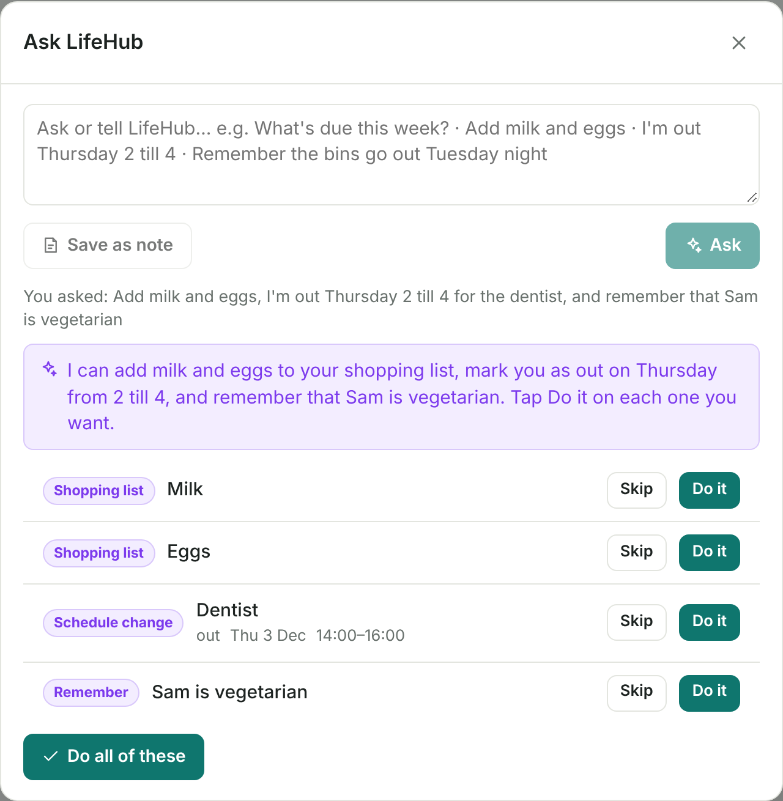
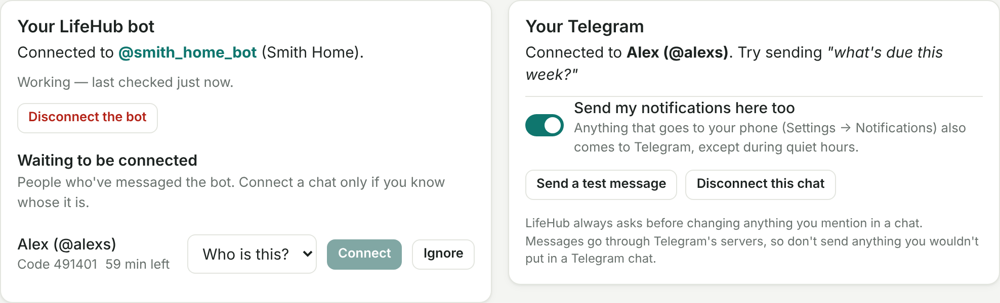

# Ask LifeHub, memory and Telegram

## Ask LifeHub

Press **Ask** at the top of any page (the **+** button on a phone), or use the box at the top of
the **AI Inbox**. Type a question or tell LifeHub what to do — in the same box:

- *What's due this week?* · *Am I free on Thursday afternoon?* · *What can I cook with what's in the fridge?*
- *Add milk and eggs* · *Remind me to call the plumber tomorrow*
- *I'm out Thursday 2 till 4* · *On holiday next week*
- *I paid the council tax* (ticks it off) · *Remember the bins go out Tuesday night*

LifeHub answers in purple, and lists anything it would change. **Nothing changes until you press
Do it** (or **Do all of these**). Press **Skip** for anything it got wrong. Anything you leave waits
in **AI Inbox → To review**, and anything you did can be undone from **AI Inbox → History**.

Ask needs an AI (**Settings → AI**). Without one, the same box adds tasks, shopping items and notes.

## Memory

**AI Inbox → Memory** is a short list of things LifeHub's AI keeps in mind: routines, diets,
people, regular arrangements — *"Sam is vegetarian"*, *"bins go out Tuesday night"*,
*"I work from home on Fridays"*. The AI uses them when it reads your email, answers questions and
suggests meals.

- Type one and press **Remember**, or tell LifeHub *"remember…"* and confirm.
- Each is just for you unless you press **Share**, so everyone's AI in the household uses it.
- Edit or forget any of them at any time. LifeHub never adds one without you confirming, and
  refuses things that look like passwords or bank details.
- Emails can't add to your memory or change your schedule — only you can.

## Telegram

Chat with LifeHub from Telegram: ask the same questions and tell it the same things. It replies
with buttons to confirm any change. It can also send you your notifications.

**Set up the bot (once, by whoever manages LifeHub)**

1. In Telegram, open **@BotFather** and send `/newbot`.
2. Give it a name (e.g. *Smith Home*) and a username ending in `bot`.
3. BotFather sends a token (a long code like `123456789:AAE…`). In LifeHub, open
   **Settings → Telegram**, paste it and press **Connect**.

**Connect your own chat (everyone)**

1. In **Settings → Telegram**, open the bot's link and press **Start** in Telegram.
2. The bot sends a 6-digit code. Type it in **Your Telegram → Connect**.

Or the admin can connect it for you: people who messaged the bot are listed under **Waiting to be
connected** — choose who it is and press **Connect**. Only connect chats you recognise.

Once connected, switch **Send my notifications here too** on or off. In the chat:
`/today` shows today at a glance, `/shopping` the shopping list, and `/stop` disconnects.

Good to know:
- LifeHub only answers chats someone connected. Anyone else just gets a code, which only works
  for an hour and only once someone enters it in LifeHub.
- Only one-to-one chats work, not groups.
- Messages pass through Telegram's servers, and your questions go to the AI you chose in
  **Settings → AI**. LifeHub itself doesn't need to be reachable from the internet.
- Switch it off any time in **Settings → Background tasks → Telegram chat**.
