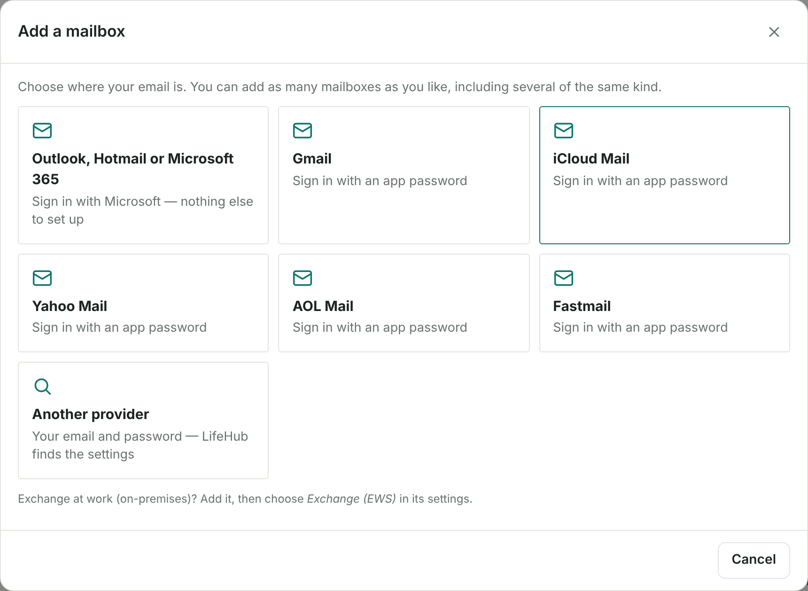

# Your email

LifeHub reads your email with its AI and turns it into tasks, calendar events, renewals and things to buy.
You can add as many mailboxes as you like, including several of the same kind (two Gmail accounts, a work
Microsoft 365 and a personal Outlook…). Each person in the household adds their own.

## Adding a mailbox

**Settings → Email → Add mailbox**, then pick where your email is:

| Your email | What you do |
|---|---|
| **Outlook, Hotmail, Live or Microsoft 365** | Press **Open Microsoft sign-in**, enter the code LifeHub shows, sign in and press **Accept**. That's all: LifeHub finds your address and starts reading. |
| **Gmail** | Make an *app password* (Google needs 2-Step Verification on): LifeHub's button opens the right page. Type “LifeHub”, press **Create**, paste the 16 letters into LifeHub, press **Connect**. |
| **iCloud Mail, Yahoo, AOL, Fastmail** | The same: LifeHub opens the provider's app-password page, you paste the password and press **Connect**. |
| **Anything else** | Enter your address and password (an app password if your provider has them). LifeHub looks up the server settings itself. If it can't, it asks for them. |

LifeHub tests the connection before saving, then checks the new mailbox straight away.

**Why app passwords?** They're separate passwords you make just for LifeHub. Your real password is never stored,
and you can withdraw an app password any time in your account's security settings without changing anything else.

**Exchange at work (on-premises)?** Use **Add manually** and choose *Exchange (EWS)*.

## How often LifeHub checks

- Whenever you **open LifeHub** (or the phone app), at most every 2 minutes.
- And every **10 minutes** while it runs. Change both in **Settings → Email** or **Settings → Background tasks**.
- The phone app on its own also checks in the background (every 15 minutes by default; see [Phone apps](phone-apps.md)).

## What LifeHub tells you

Instead of a notification for every email, you get **one per check**, for example:

> **From your email: 2 tasks, 1 renewal**
> • Pay council tax
> • Send Sam the photos
> • Car insurance

Offers from marketing emails go quietly into the AI Inbox's **Promotions** list and are never notified. Tap the
notification to review or undo what was added. Choose how (or whether) you're told in
[Notifications](notifications.md).

## Setting up Microsoft sign-in (once, for whoever publishes LifeHub)

The **Sign in with Microsoft** button needs LifeHub to be registered with Microsoft once. It's free and takes about
five minutes. One registration works for everyone who uses your copy of LifeHub.

1. Go to [entra.microsoft.com](https://entra.microsoft.com) → **App registrations → New registration**.
2. Name: **LifeHub**. Supported account types: **Accounts in any organizational directory and personal Microsoft
   accounts**. Leave the redirect URI empty. Press **Register**.
3. **Authentication → Advanced settings → Allow public client flows: Yes** → **Save**.
4. **API permissions → Add a permission → Microsoft Graph → Delegated**: `Mail.ReadWrite`, `Calendars.ReadWrite`,
   `User.Read`, `offline_access` → **Add permissions**.
5. Copy the **Application (client) ID** from the Overview page, then either:
   - **for everyone using your releases:** GitHub → your repository → **Settings → Secrets and variables → Actions →
     Variables → New repository variable**, name `MS_CLIENT_ID`. Every build (desktop, Docker, Home Assistant,
     phone) then has it built in; or
   - **for one LifeHub:** **Settings → Email → Microsoft sign-in (admin)**, paste it and **Save** (or set the
     `LIFEHUB_MS_CLIENT_ID` environment variable).

`Mail.ReadWrite` is only used to move an email to Deleted Items when you delete its task (you can turn that off).
LifeHub never sends email and never deletes anything permanently.

**Google sign-in?** Google only lets public apps read Gmail after a paid security review, and limits unreviewed apps
to 100 hand-picked testers whose sign-ins expire every week, so LifeHub uses app passwords for Gmail instead.
