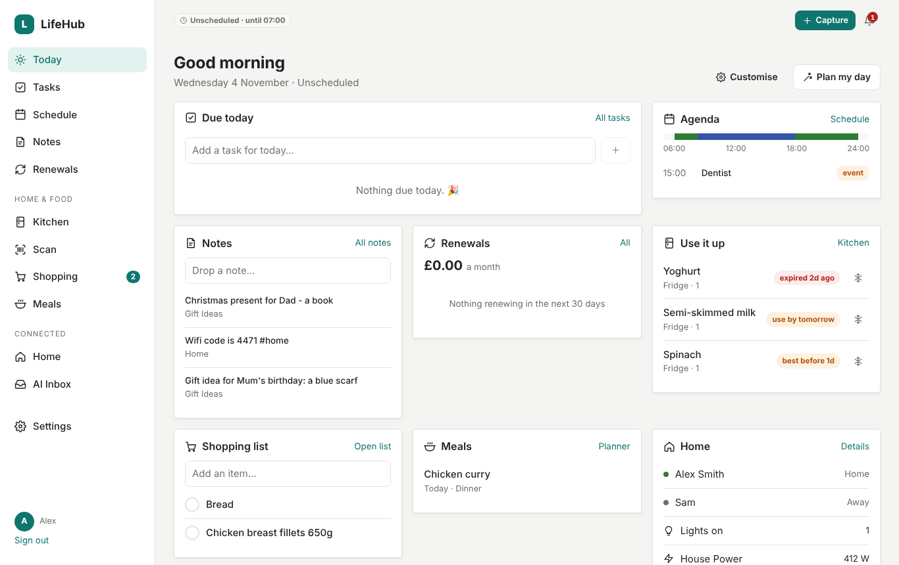

# Getting started

A quick tour once LifeHub is running.

## The home screen

**Today** shows what matters now: tasks due, your agenda, renewals coming up, food to use up,
the shopping list and meals. Each card is a section of LifeHub — tap its title to open it.

Press **Customise** to show, hide and reorder the cards.

## Try these first

1. **Ask LifeHub**: the **Ask** button at the top. Type naturally, e.g. *"Dentist Friday 3pm"*,
   *"add milk"* or *"what's due this week?"*, then press **Do it** on what it suggests
   ([more](ask-and-telegram.md)). Without an AI, the same button adds tasks and shopping.
2. **Set your week**: **Schedule → My usual week** — the days and hours you work. Add holidays and
   time out with **Time off or plans** ([more](schedule.md)).
3. **Add a renewal**: **Renewals → Add**, e.g. your car insurance with its renewal date. LifeHub
   reminds you before it's due.
4. **Stock the kitchen**: **Scan** (on your phone) and scan a barcode, or **Kitchen → Add**.
   Use-by dates count down; LifeHub tells you what to use first.
5. **Plan meals**: **Meals → Plan**, then **Suggest improvements** for AI ideas that fit your
   week.
6. **Drop a note**: **Notes**, type anything — a link, a gift idea, a door code.

## Where things are

| Section | What it's for |
|---|---|
| Today | Your day at a glance |
| Tasks | To-dos with dates, priorities and repeats |
| Schedule | Your working hours, time off and plans; **Plan my day** fits tasks into free time |
| Notes | Quick notes, sorted into categories for you |
| Renewals | Subscriptions, insurance, bills and their dates |
| Kitchen / Scan / Shopping / Meals | Food at home, the shopping list and the meal plan |
| Home | Your Home Assistant rooms (when connected) |
| AI Inbox | Ask LifeHub, emails turned into tasks and events, and what the AI remembers |
| Settings | Everything else |

Don't need some of these? Turn them off in **Settings → Modules** — see [Make it yours](customise.md).

## Next steps

- [The AI assistant](ai.md) — sorts notes, reads emails, plans meals.
- [Phone apps](phone-apps.md) — LifeHub in your pocket, also offline.
- Connect your email: **Settings → Email** ([details](../email-and-ai.md)).
- Connect Home Assistant: **Settings → Home Assistant** ([details](../home-assistant.md)).
- Notifications on your phone: **Settings → Notifications**.
- Chat with LifeHub on Telegram: **Settings → Telegram** ([details](ask-and-telegram.md#telegram)).
