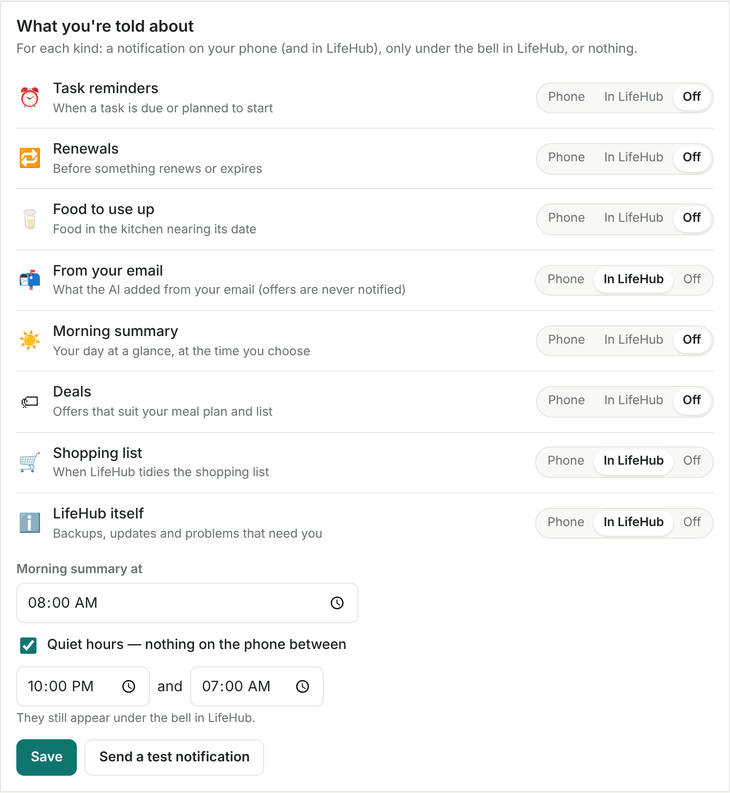

# Notifications

LifeHub tells you when things are due, what it added from your email, and what to use up in the kitchen.
Everything also appears under the **bell** at the top of LifeHub.

## Choosing what you're told about

**Settings → Notifications → What you're told about.** For each kind, choose **Phone** (a notification on your
phone, and under the bell), **In LifeHub** (only under the bell) or **Off**:

| Kind | When | Starts as |
|---|---|---|
| Task reminders | 15 minutes before a task is due or planned | Phone |
| Renewals | Before something renews or expires | Phone |
| Food to use up | Once a day when food is nearing its date | Phone |
| From your email | One summary per email check (offers are never notified) | Phone |
| Morning summary | Your day at a glance, at the time you choose | Phone |
| Deals | Offers that suit your meal plan and list | In LifeHub |
| Shopping list | When LifeHub tidies the list | In LifeHub |
| LifeHub itself | Backups, updates and problems | In LifeHub |

**Quiet hours** keep the phone silent between the times you choose; notifications still collect under the bell.

Each person chooses their own.

## How they reach your phone

- **The LifeHub phone app** shows them itself, tidily: one group for LifeHub, and a separate Android channel (or iOS
  thread) for each kind, so you can also silence a kind in the phone's own settings.
- **Home Assistant's app** or **web notifications** in a browser: **Settings → Notifications → How notifications
  reach your phone**.
