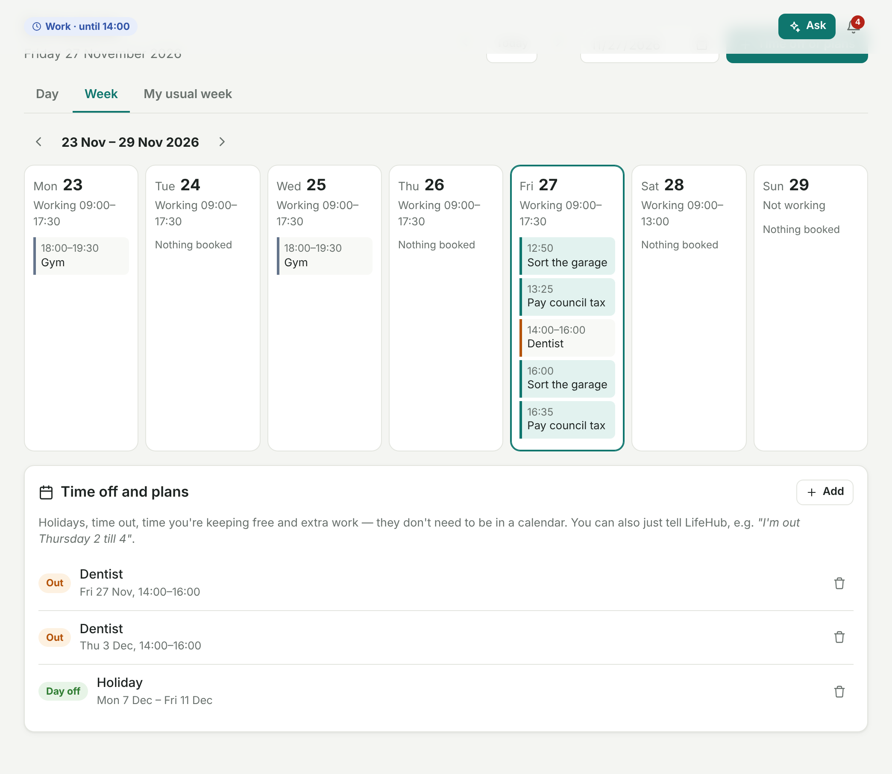

# Your schedule

**Schedule** knows when you're working, when you're free, and when you're out or busy — even if
it isn't in a calendar. LifeHub uses it to plan tasks into free time (**Plan my day**), to show
what kind of time it is on **Today**, and to answer questions like *"am I free Thursday
afternoon?"*.

## My usual week (set it once)

**Schedule → My usual week**

- **When I work**: switch on the days you work and set your hours for each. Different hours on
  some days? Just change them. **Use Monday's hours on every work day** copies one day to the rest.
- **My day**: when your day starts and ends, on work days and on days off. Nothing is planned
  outside these times.
- **Regular times to keep free**: things you do every week at the same time, like the gym, the
  school run or a club. Add one, give it a name, tick the days and set the times.
- **Which tasks go where**: work tasks go into work time, everything else into free time. Change
  it per task category.

Press **Save**. Each person in the household has their own week.

Need something unusual, like two shifts in a day or focus time? **Edit every period in detail**
shows every period of the week as a table.

## Time off and plans (one-offs)

Press **Time off or plans** at the top of Schedule. Choose what it is:

| Choose | For | What LifeHub does |
|---|---|---|
| **Day off** | Holiday, leave, a sick day — or part of a day | Work time becomes free time |
| **Out** | An appointment, visiting someone, away for the day | Plans nothing while you're out |
| **Keep free** | Time you've set aside, e.g. family time | Plans nothing then |
| **Working** | An extra shift or different hours | Counts as work time |

Pick the day (tick **More than one day** for a holiday), untick **All day** to set times, and press
**Add**. Remove one with the × on the day, or the bin in **Week → Time off and plans**.

You can also just tell LifeHub, in the app or on Telegram:
*"I'm out Thursday 2 till 4"*, *"on holiday 3rd to 7th March"*, *"keep Saturday morning free"*.
It shows what it understood and adds it when you press **Do it**.

All-day calendar events with words like *holiday* or *annual leave* count as days off too. Change
the words under **My usual week → Planning**.

## The day and week views

- **Day** shows the day's timeline: your usual periods, time off and plans, calendar events and
  planned tasks. **Suggest a plan** fits open tasks into free gaps; **Apply plan** keeps it.
- **Week** shows seven days side by side: whether you're working, time out and kept free, events
  and planned tasks. Tap a day to open it.

## Planning automatically

**My usual week → Automatic planning** plans tomorrow every evening and fits in anything new each
morning (both can be switched off). Only tasks without a time are planned, and never into time
you're out or keeping free.
