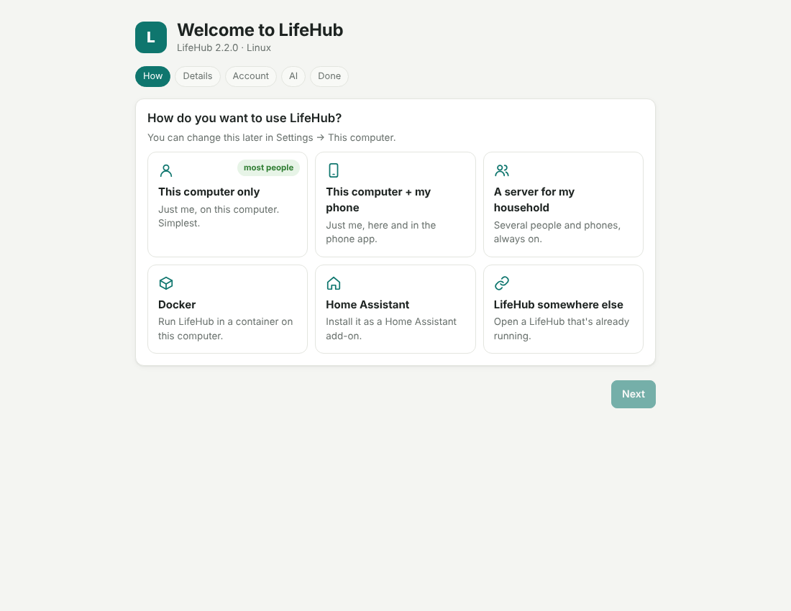

# Installing LifeHub on Windows

Works on **Windows 10 (version 1809 or later) and Windows 11**, 64-bit.

## Install

1. Download **`LifeHub-<version>-Windows-x64-Setup.exe`** from the
   [Releases page](https://github.com/shotgn16/LifeHub/releases/latest).
2. Double-click it.
   - **"Windows protected your PC"?** LifeHub isn't signed with a paid certificate yet. Click
     **More info → Run anyway**.
3. Follow the installer: **Next → Install → Finish**. Leave **Open LifeHub and set it up** ticked.

The installer adds everything LifeHub needs, including Microsoft Edge WebView2 (the part of
Windows that draws the LifeHub window) if your PC doesn't already have it. No administrator
password is needed — LifeHub installs just for you.

## Set it up

LifeHub opens with its **setup assistant**:

1. **How do you want to use LifeHub?** Pick one and press **Next**:
   - **This computer only**: the simplest. LifeHub runs while the app is open.
   - **This computer + my phone**: LifeHub keeps running in the background (starting when you
     sign in to Windows) so your phone app can always reach it.
   - **A server for my household**: like the above, but for several people. Choose **When the
     computer starts** (Windows asks for permission once) or **When I sign in**.
   - **Docker** / **Home Assistant** / **LifeHub somewhere else**: see [Docker](docker.md) or
     [Home Assistant](home-assistant.md).
2. **Allow access?** For the phone and server options, Windows Firewall may ask whether LifeHub
   may use your network. Tick **Private networks** and press **Allow**.
3. **Create your account**: your name, a username and a password (8 characters or more).
4. **The AI assistant**: LifeHub checks for Ollama. If it isn't installed, press **Yes, install
   Ollama** and LifeHub downloads and installs it, then downloads a model that suits your PC. Or
   press **No thanks** and set it up later (see [The AI assistant](ai.md)).
5. **Connect your phone** (phone and server options): the address and API key to type into the
   phone app. See [Phone apps](phone-apps.md).
6. **Open LifeHub**. That's it!

## Every day

- Open **LifeHub** from the Start menu (or the desktop shortcut).
- **Start menu → LifeHub setup assistant** runs the assistant again, for example to switch from
  "this computer only" to "this computer + my phone".
- Your data is kept in `%LOCALAPPDATA%\LifeHub` (paste that into the File Explorer address bar).
  LifeHub backs it up every night into the `backups` folder there.

## Updating

Download the new Setup.exe and run it. Your data and settings are kept.

## Uninstalling

**Settings → Apps → Installed apps → LifeHub → Uninstall.** The background service is removed,
and you're asked whether to delete your data as well (choose **No** to keep it for later).
