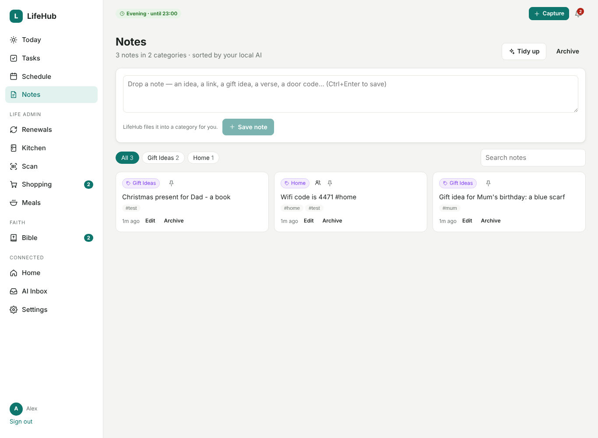

# Notes

**Notes** is a place to drop little bits of text: an idea, a link, a gift idea, a verse, a door
code, a film to watch. LifeHub keeps them and sorts them into categories for you.

## Dropping a note

You can add a note in any of these ways:

- **Notes page**: type in the box at the top and press **Save note** (or Ctrl+Enter).
- **Quick capture**: the **+ Capture** button → **Note**.
- **Share sheet**: share text or a link to LifeHub from your phone. If it isn't a Bible passage,
  press **Save it as a note**.
- **API**: `POST /api/v1/notes {"text": "…"}`. This works from an iPhone Shortcut, Assist or an NFC
  tag (see [api.md](api.md)).

Add `#tags` anywhere in the text to group notes yourself.

## How notes are sorted

With the local AI switched on (Settings → AI), each new note is filed in the background:

- **Category.** It reuses one of your categories when one fits, such as "Gift Ideas", "Recipes",
  "Home" or "Faith". It only makes a new category when none fits.
- **Tags.** Up to four keywords that help you find the note later.
- **Heading.** A short heading, shown only for long notes.

The AI **never changes your text**. Categories it picked are shown in purple, and ones you chose in
grey.

Without the AI, simple rules make a first guess (links, gift ideas, recipes, faith, books & films,
ideas). Everything else goes in **Unsorted**.

## Keeping it tidy

- **Change a note's category**: tap its category label, then type a new one or pick an existing
  one. The AI won't move that note again.
- **Rename or merge a category**: open it and press **Rename**. Renaming it to an existing name
  merges the two.
- **Tidy up**: the AI files all your notes again in batches. Similar notes end up together, and
  near-duplicate categories ("Presents" / "Gift Ideas") are merged. Notes whose category you set
  yourself are left alone.
- **Pin** a note to keep it at the top. **Archive** hides it without deleting it; delete it from
  the Archive.
- **Search** looks through note text, headings, categories and tags.

## Private or shared

Notes are **private** by default. With several people (see [people.md](people.md)), you can:

- tick **Share with the household** when you save a note
- or press **Share** on an existing note

Shared notes show the author's name and appear under **Shared** for everyone. Only the author can
edit them.
