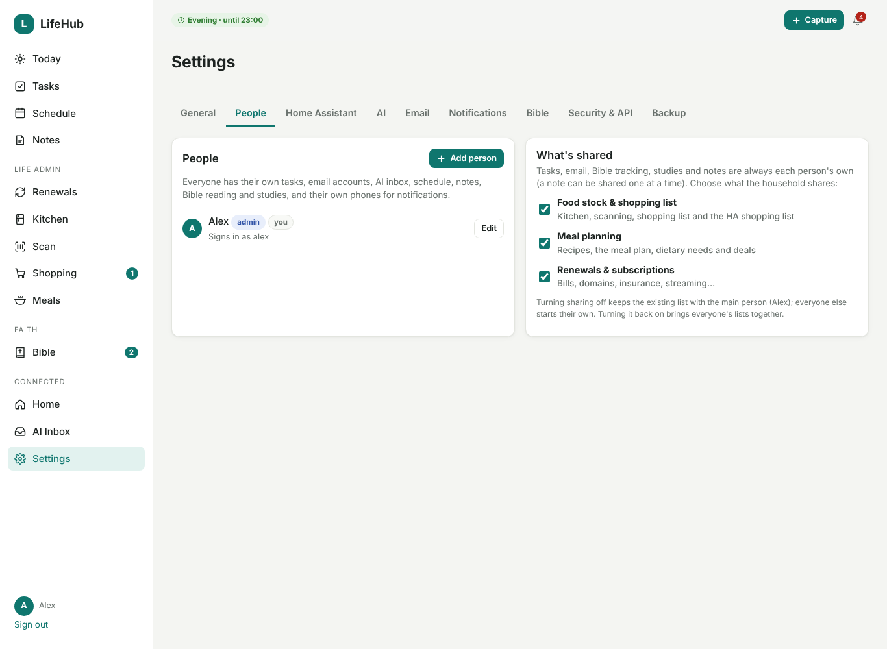

# People & sharing

LifeHub 2.0 lets several people use one LifeHub. Each person gets their own space, and you choose
what the household shares.

| Always each person's own | Shared or personal (your choice) |
|---|---|
| Tasks and the schedule they're planned into | Food stock, the shopping list and purchase history |
| Email accounts, the AI inbox and promotions | Recipes, the meal plan, dietary needs and deals |
| Bible reading, the verse of the day, reading plan, streak and app time | Renewals and subscriptions |
| Bible studies, starter notes and Go deeper | |
| Notes (each note can be shared on its own) | |
| Phones and devices for notifications, calendars, the HA tasks list | |
| Reminders and the morning digest | |
| API key | |

The household-wide settings are shared: Home Assistant, the AI, the kitchen setup, and so on.

## Adding someone

1. Go to **Settings → People → Add person** (admins only).
2. Enter their name and pick a colour.
3. Optionally link their **Home Assistant person**. Their "while you're out" shopping reminder then
   goes to their phone.
4. Optionally give them a **username and password**. They need these to use LifeHub outside Home
   Assistant (the direct port or your own web address).
5. Tick **Admin** if they should be able to change household settings, such as Home Assistant, the
   AI, people and sharing.

New people start with the household's default schedule and Bible settings. They then set up their
own in Settings:

- **Email**: their own mailboxes
- **Home Assistant**: their phones, calendars and tasks list
- **Notifications**: how reminders reach them
- **Bible**: their app sensor, plan and reminder
- **Security & API**: their password, PIN and API key

## Signing in

- **In the Home Assistant app or sidebar**:
  - With one person, Home Assistant's sign-in is used, as before.
  - With several people, LifeHub asks **"Who's using LifeHub?"** and each person taps their name.
    Add a **PIN** in Settings → Security & API so nobody else can pick you.
  - **Switch person** in the menu goes back to that screen.
- **Direct port or your own address**: each person signs in with their own username and password.
- **API**: each person has their **own API key**. A Shortcut or HA automation using Sam's key adds
  Sam's tasks, logs Sam's Bible reading, and so on.

## Sharing

Choose what's shared in **Settings → People → What's shared**:

- **Shared:** everyone sees and edits one list, for example one fridge and one shopping list.
- **Not shared:** each person has their own.

Turning sharing **off** keeps the existing list with the **main person** (the first admin), and
everyone else starts an empty one. Turning it back **on** brings everyone's lists together again.

With meal planning shared, the planner also takes other people's calendars into account. For
example, "Sam: football 18:00" makes that evening a quick-meal night.

## Removing someone

Go to **Settings → People → Edit → Remove**. The following of theirs are **deleted**:

- tasks
- emails and mailboxes
- AI inbox
- notes
- Bible history
- studies

Anything they added to the kitchen, meals or renewals **stays with the household**. Their sign-in
and API key stop working immediately.

## Upgrading from 1.x

Nothing changes until you add someone. On upgrade:

- your existing login, API key, phones, calendars, schedule and Bible settings become the first
  person's
- all existing data stays theirs, or stays shared in the shared areas
- existing Shortcuts and automations keep working with the same API key

## Home Assistant sensors

The household sensors (`sensor.lifehub_tasks_due`, `sensor.lifehub_bible_streak`, …) show the main
person. Everyone else gets their own copies:

- `sensor.lifehub_tasks_due_<name>`
- `sensor.lifehub_bible_streak_<name>`

For example, `sensor.lifehub_bible_streak_sam`.
